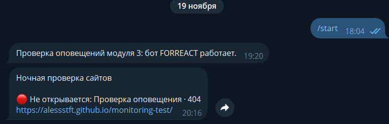

# Мониторинг сайтов группы

Моё второе приложение модуля 3. Оно не зависит от PocketBase: читает
`public/data/sites.json` и `public/data/results.json`, поэтому его можно
опубликовать на GitHub Pages.

## Список сайтов

В `public/data/sites.json` семь адресов: четыре опубликованные на Pages
работы нашей группы (главная страница, этот монитор, PPTX → SCORM, дома
Санкт-Петербурга), два справочника курса и ссылка на бота оповещений.
Седьмой пункт «Проверка оповещения» ведёт на https://t.me/FORREACT_bot:
страница бота отвечает 200, поэтому карточка зелёная и показывает
«Работает · N мс». Чтобы снять снимок сообщения бота, я временно
подставляла неработающий адрес и обнуляла историю проверок. У каждого сайта
свой `id` латиницей.

## Страницы

| Адрес | Что показывает |
| --- | --- |
| `/` | сводку «Не открываются: N из M», кнопку «Только неработающие», карточки со статусом, временем ответа и долей удачных проверок |
| `/site/:id` | сайт, счётчик удачных проверок, таблицу истории с полосами времени ответа и подсветкой неудачных |
| `/about` | как устроена ночная проверка |
| `*` | «Страница не найдена» |

Меню в шапке — на `NavLink`, активный пункт выделяется белым. Данные
страницы получают хуком `useMonitoring()` из `MonitoringProvider`, без props.
`BrowserRouter` подключён с `basename={import.meta.env.BASE_URL}`, потому что
сайт на Pages лежит в подпапке `/monitoring/`.

## Запуск

```powershell
npm install
npm run dev          # http://localhost:5173/monitoring/
npm run build
npm run lint
npm run preview      # http://localhost:4173/monitoring/
node scripts/check.mjs
```

`npm run build` складывает готовые файлы в `dist`. Файлы из `public`
попадают туда как есть, их можно обновлять без пересборки — этим пользуется
ночная проверка.

## Ночная проверка

`scripts/check.mjs` запрашивает каждый сайт из списка с ограничением
15 секунд, записывает код ответа и время в `results.json` и хранит
30 последних проверок. В конце сравнивает новую проверку с прошлой
(`history[1]`) и отправляет в Telegram сообщение только если сайт перестал
открываться или снова заработал. На трёх пробных запусках все семь адресов
ответили 200, поэтому сообщений не было — «Изменений нет, сообщение не
отправлено». Так и задумано: бот пишет только о переходах «работал ⇄ не работает».

Токен и номер чата читаются из `process.env`; на моём компьютере их нет,
скрипт пишет об этом и не падает.

```
.github/workflows/check.yml    cron '0 21 * * *' = 00:00 по Москве,
                               Run workflow, коммит бота, задание publish
.github/workflows/deploy.yml   push в main, workflow_call, сборка, 404.html, Pages
```

`publish` вызывает `deploy.yml` через `workflow_call`, потому что коммит
от `GITHUB_TOKEN` сам по себе не запускает другие конвейеры. В `deploy.yml`
у checkout стоит `ref: main`, чтобы сборка взяла уже обновлённый
`results.json`, и есть шаг `cp dist/index.html dist/404.html` — так прямые
ссылки на страницы открываются на Pages.

## Публикация

Репозиторий: https://github.com/alessstft/monitoring
Сайт: https://alessstft.github.io/monitoring/
Бот оповещений: https://t.me/FORREACT_bot

ТГ-бот фото:



Секреты в коде и в истории Git не встречаются, в журнале запуска GitHub
показывает их как `***`.

Подробнее по модулю — в `..\modul-3\README.md`, подготовка к защите —
в `..\projects\p3-monitoring\Подготовка к защите.md`.
